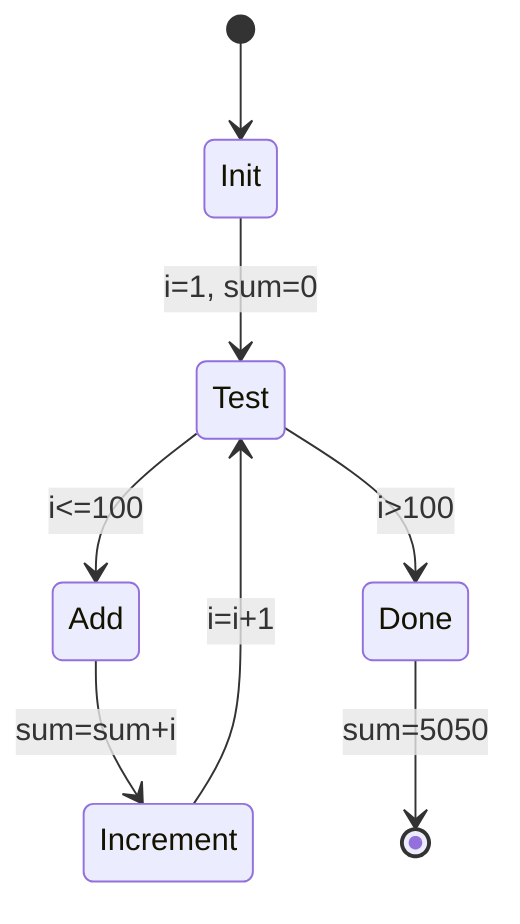

# PA1 必答题参考与复现记录

对应 [PA1 必答题](https://ysyx.oscc.cc/docs/ics-pa/1.7.html)。这是 AI 编写的讲解参考，不是学习者的独立报告；没有虚构学号、学习时长或个人操作经历。

## 程序的状态机

取状态 `(阶段, i, sum)`，初始 `(init, 0, 0)`。转移如下：



这是一份紧凑的参数化状态图：不是只有五种机器状态，`i` 与 `sum` 的不同取值也是状态的一部分。每次到达 Test，满足不变式 `sum=(i-1)*i/2`。初始 i=1 时成立；加入 i 并把 i 加一后仍成立；i=101 时终止，sum=5050。若展开到真实指令级，状态还应包含 PC、通用寄存器和内存，每次边对应执行一条指令。

## 调试基础设施的时间计算

调试次数为 `500*90%=450`。原方法花费 `450*20*30=270000` 秒，即 75 小时；简易调试器花费 `450*20*10=90000` 秒，即 25 小时；按题设节省 50 小时。这是题目的估算，不是本项目实际用时。

## 在 RISC-V 手册里定位

在 [RV32I 章节](https://docs.riscv.org/reference/isa/v20260120/unpriv/rv32.html) 找到 Base Instruction Formats 和 Immediate Encoding Variants：基本布局为 R、I、S、U，分支与跳转立即数另用 B、J 变体，教学中通常合称 R/I/S/B/U/J 六种格式。不要把一个汇编指令名字误当成一种格式。

同章 Integer Computational Instructions 中查 LUI：U 型立即数放到目标寄存器高 20 位，低 12 位清零；RV32 中即 `rd=imm20<<12`，写 x0 仍无效。

在 [Machine-Level ISA](https://docs.riscv.org/reference/isa/v20260120/priv/machine.html) 的 Machine Status Registers（mstatus/mstatush）小节查看 RV32 布局图与字段说明。先确认 XLEN=32；RV32 的高部分由 mstatush 承载。重点读 MIE/MPIE 中断使能、MPP 先前特权级、MPRV 访存特权，以及与扩展相关的状态字段。具体有效字段受实现扩展影响，本阶段只学习定位和含义，没有实现 CSR。

## 源码行数

2026-11-18 使用 `python3 pa1/count.py`（或 `make -C pa1 count`）实际得到：

- 上游固定基线：114 个 C/H 文件，17,516 行，非空 15,301 行。
- PA1 补丁后的源码：116 个文件，17,434 行，非空 15,289 行。
- 行级对比：新增 242 行、删除 324 行，净减少 82 行。

统计口径是固定基线 Git 跟踪的 C/H 加上本项目新增的 PA1 C/H，排除 build、外部依赖和 PA2 解码器变更。净减少是因为替换了上游占位/调试器实现，不能据此说“没写代码”。新增行数也不等于学习者独立编写的行数；本次代码由 AI 编写。没有以当前 PA2 文件冒充 PA1 阶段统计。

若题目要求字面意义上的整个目录（包含生成文件和下载代码），在 NEMU 目录可运行：

```bash
find . -type f \( -name '*.c' -o -name '*.h' \) -print0 | xargs -0 cat | wc -l
find . -type f \( -name '*.c' -o -name '*.h' \) -print0 | xargs -0 cat | sed '/^[[:space:]]*$/d' | wc -l
```

这两个数字会随构建产物变化，不能与上面固定口径混用。脚本通过 `git show <base>:<path>` 读取旧内容，不需要切分支或覆盖现有工作。

## -Wall 与 -Werror

`-Wall` 打开一组常用、容易发现可疑代码的警告，并不表示 GCC 所有警告都打开。`-Werror` 把已触发的警告提升为错误，使构建失败。组合使用可避免遗漏类型、未初始化变量等问题，但编译通过不等于功能正确，仍需运行测试。参见 [GCC Warning Options](https://gcc.gnu.org/onlinedocs/gcc/Warning-Options.html)。NEMU 实际路径是 `scripts/build.mk`，讲义中的 `scripters` 是路径拼写差异。
