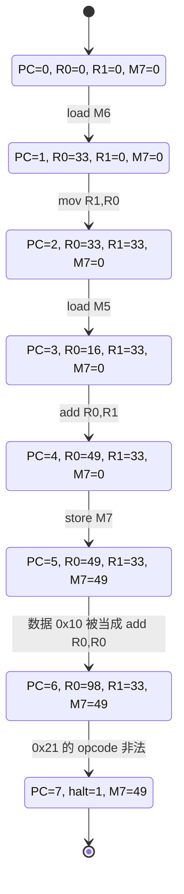

# PA2 必答题参考与实测

对应官方 PA2 讲义。以下为 AI 编写的学习参考；请依据自己的理解重写个人报告。所有编译实验在 NEMU 的临时副本中执行，原工作环境未加入实验用 dummy 变量。

## 程序是状态机：YEMU 到 NEMU

把机器状态记为 S=(PC,R,M)。YEMU 循环一次，先按 PC 取指，再按 opcode 解码，读取寄存器/立即数，计算结果并更新寄存器、内存和 PC；这个函数就是一步转移 S→S'。寄存器只是状态的一部分，PC 决定下一次执行哪条指令，内存保存指令和数据。假如只有寄存器相同而 PC 不同，机器也可能走向不同结果。

把每条指令的效果记录为“旧 PC、指令、源值、目的值、新 PC”，就能逐步推演整个程序。NEMU 增加更多指令、调试器和设备后，核心仍是这个过程；设备加入时，可把状态扩展成 (PC,R,M,D)，外部键盘输入是影响设备状态的事件。

讲义中 x=16、y=33 的 YEMU 示例可以具体展开如下（未列出的寄存器保持 0）：

这个原始示例没有独立 halt 指令，所以写入结果后还会执行数据区域，最终借非法 opcode 停止；最终结果是 M7=49，而不是此时已经变成 98 的 R0。状态图中的每条边对应 exec_once 的一次执行。参见 [YEMU 原例](https://ysyx.oscc.cc/docs/ics-pa/2.1.html)。

## 本工程的一条指令怎样执行

用户在 sdb 输入 si/c 后进入 cpu_exec，执行循环调用 exec_once；它准备 Decode 中的 pc/snpc，调用 isa_exec_once。inst_fetch 经 vaddr_ifetch 读取客户内存，并让 snpc 增加指令长度。我们的 isa_exec_once 把机器码交给 rv32_execute，读取旧寄存器、生成立即数，计算结果并写回，给出 dnpc。

例如 lw：地址=rs1+符号扩展立即数，vaddr_read/paddr_read 根据地址访问 RAM 或设备映射；数据写入 rd（x0 例外），dnpc=pc+4。exec_once 随后更新 cpu.pc；trace_and_difftest 中的监视点钩子在指令完成后检查表达式。如果值变化且机器仍在 RUNNING，改为 STOP；如果已经 EBREAK/ABORT，保留终止状态。

这说明编译器生成的是客户机器码，执行客户机器码的是 NEMU 的 C 逻辑；NEMU 自己又被宿主的 x86 处理器执行。RTL NPC 则由 Verilator 将硬件描述转成仿真代码，状态更新由时钟边沿驱动。

## 打字小游戏怎样运行

上层程序轮询 AM_INPUT_KEYBRD，通过 AM 得到键码和按下/松开标志；AM 驱动读取键盘 MMIO 地址，NEMU 从队列取出事件。队列中的事件来自宿主 SDL，不能把宿主键码直接当作 AM 键码，需要映射。

程序更新字母位置、命中等状态后调用 AM_GPU_FBDRAW，驱动将像素写入显存并设置同步寄存器；NEMU 消费同步标记、更新 SDL 纹理并显示。时间推进通过 AM_TIMER_UPTIME，底层读时钟设备的微秒数。游戏源代码依赖 AM 接口，具体地址和 SDL 实现由平台层承担。本次实际验证的是同一 IOE 链路的键盘/显存测试与 LiteNES，不把这一说明冒充打字小游戏的运行记录。

## inst_fetch 的 static 和 inline

本机默认优化构建的实际结果：只去掉 static，编译链接成功；只去掉 inline，成功；两者都去掉，链接时报 inst_fetch 多重定义，分别来自 inst.o 和 hostcall.o。

static 让头文件中的定义具有内部链接，每个翻译单元拥有自己的函数。inline 不是“必定内联”的命令，还涉及 C 的外部定义规则。去掉 static 后，本次优化把所需调用内联掉了，因此没有留下缺少外部定义的引用；这并不保证所有优化级别都成功。额外的两个翻译单元、C11/-O0 实验中，只有 inline 会出现 undefined reference；static inline 和 static 均成功；两者都没有则 multiple definition。详见 [原始实验结果](evidence/week16-linkage.json)。

复现：`python3 pa2/linkage_experiments.py`。不要仅凭一次成功就断言 inline 会产生可供其他文件使用的外部函数体。

## 头文件里的 dummy 实体

固定当前 NEMU 配置，以 nm -a 检查最终可执行文件，实际结果：只在 common.h 加 `volatile static int dummy;` 有 31 个实体；common.h 与 debug.h 都加同样声明，仍为 31 个；两处都写 `volatile static int dummy = 0;` 则编译失败，提示重定义。

static 使变量按翻译单元隔离；头文件被多个源文件包含时，各翻译单元有各自的实体。同一翻译单元中相同类型、相同链接的多次暂定定义可以合并；带初始化器的定义不能这样重复。volatile 在本实验中使这些对象保留，nm 能看到各自的本地 bss 符号。31 是当前配置实际链接的结果，不是所有 NEMU/编译配置的常数。

## make ARCH=riscv32-nemu 如何得到 hello.elf

应用 Makefile 定义 NAME/SRCS 并包含 AM_HOME/Makefile。AM 依据 ARCH 选择 ISA 和平台脚本，组合交叉编译器、头文件路径、编译选项、启动汇编和库源文件。C 源经预处理包含头文件，再编译/汇编为对象；依赖文件用于检测头文件变化。am 和 klib 分别归档成静态库。

链接器按 linker.ld 将应用对象、启动代码、所需库函数放入客户地址空间，解析符号和重定位，得到 ELF；入口 _start 设置栈后调用 _trm_init，再调用 main，返回后 halt。objcopy 去除 ELF 元数据得到加载用 .bin，objdump 生成 .txt 反汇编。make 根据时间戳和依赖图只重建必要目标；用 `make -n ARCH=riscv32-nemu` 看将要执行的命令，用构建输出里的 CC/AS/AR/LD 对照各阶段。

在 NPC 上过程相似，但 minirv-gcc 会先转换汇编，平台的 putch/halt 也换成 NPC 版本。地址由平台决定，因此同一 AM 源码需要针对平台重新编译。

参考：[PA2 必答题](https://ysyx.oscc.cc/docs/ics-pa/2.5.html)、本项目 pa2/linkage_experiments.py 以及固定 NEMU/AM checkout 中的实际构建规则。本次没有伪造学号.pdf 或执行课程平台 submit。
